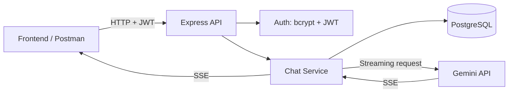

<div align="center">

# 🤖 AI Chat Backend

**Backend trò chuyện AI — gọn gàng để phát triển, rõ ràng để tích hợp.**

Express · TypeScript · PostgreSQL · JWT · Gemini Streaming

[](https://nodejs.org/)
[](https://expressjs.com/)
[](https://www.typescriptlang.org/)
[](https://www.postgresql.org/)

[🚀 Bắt đầu](#-bắt-đầu-trong-5-bước) · [📖 Swagger](#-swagger--thử-api-trực-tiếp) · [🔌 API](#-api-reference) · [🧩 Tài liệu FE](#-tài-liệu-tích-hợp-frontend)

</div>

---

## ✨ Tổng quan

AI Chat Backend cung cấp API để đăng ký/đăng nhập, quản lý hội thoại, lưu lịch sử tin nhắn và nhận phản hồi **Gemini theo thời gian thực qua SSE**.

| Thành phần | Công nghệ / vai trò |
| --- | --- |
| API server | Express + TypeScript |
| Database | PostgreSQL, truy vấn trực tiếp bằng `pg` |
| Authentication | `bcrypt` + JWT, do backend quản lý |
| AI | Gemini streaming qua Server-Sent Events (SSE) |
| API playground | Swagger UI / OpenAPI JSON |
| Database hosting | Có thể dùng PostgreSQL trên Supabase; **không dùng Supabase Auth/Data API** |

### 🌟 Những gì đã hỗ trợ

- 🔐 Đăng ký, đăng nhập và xác thực Bearer token.
- 💬 Tạo hội thoại, lấy danh sách hội thoại và lịch sử tin nhắn.
- ⚡ Stream phản hồi Gemini qua SSE.
- 🔁 Retry tin nhắn AI thất bại; chỉnh sửa tin nhắn người dùng và tạo phản hồi mới.
- 📝 Đổi tên, 🗑️ xóa hội thoại cùng toàn bộ tin nhắn.
- 🛡️ Kiểm tra quyền sở hữu, transaction, idempotency và chống kết quả AI cũ ghi đè.

## 🏗️ Kiến trúc ở mức tổng quan



**Phân chia trách nhiệm:** `Conversation` quản lý danh sách/đổi tên/xóa; `Message` đọc/ghi tin nhắn; `Chat` điều phối hội thoại, lịch sử, Gemini và streaming. `ChatRepository` xử lý transaction cho send/retry/edit, idempotency và bảo vệ kết quả theo generation. Khi xóa hội thoại, backend dùng cùng khóa conversation với send/edit/retry và **không giữ transaction trong lúc gọi AI**.

## 🚀 Bắt đầu trong 5 bước

**Yêu cầu:** Node.js **22+**, npm và PostgreSQL có thể kết nối.

### 1. Mở thư mục backend

```powershell
cd ai-chat-be
```

### 2. Chuẩn bị môi trường

Tạo `.env` từ `.env.example` **chỉ khi chưa có**. Không ghi đè `.env` đã chứa secret.

| Biến | Mục đích |
| --- | --- |
| `DATABASE_URL` | URI PostgreSQL từ Supabase → **Connect → Session pooler** |
| `DATABASE_CA_FILE` | Đường dẫn chứng chỉ CA nếu kết nối TLS cần |
| `JWT_SECRET` | Secret ngẫu nhiên **ít nhất 32 byte**, chỉ lưu trên backend |
| `JWT_EXPIRES_IN` | Mặc định `1h`; hỗ trợ từ 60 giây đến 7 ngày |
| `GEMINI_API_KEY` | API key Google AI Studio |
| `GEMINI_MODEL` | Model Gemini được sử dụng |
| `CORS_ORIGIN` | URL frontend; mặc định `http://localhost:5173` |

> [!IMPORTANT]
> `DATABASE_URL` là **PostgreSQL connection URI**, không phải Supabase API key. Điền mật khẩu database thật và URL-encode ký tự đặc biệt. Ưu tiên **Session pooler cổng 5432**; transaction pooler cổng 6543 cũng được hỗ trợ vì code không dùng named prepared statements.

> [!NOTE]
> Kết nối PostgreSQL sử dụng TLS và kiểm tra chứng chỉ. Nếu gặp lỗi CA, tải certificate từ Supabase và thiết lập `DATABASE_CA_FILE`; **không tắt certificate verification**. Không cần Supabase URL/publishable/secret API key ở runtime; biến cũ có thể giữ tạm trong `.env` nhưng code không sử dụng.

### 3. Cài dependencies

```powershell
npm.cmd install
```

### 4. Kiểm tra và chuẩn bị database

```powershell
npm.cmd run db:check
npm.cmd run db:migrate
npm.cmd run db:types
```

| Lệnh | Tác dụng |
| --- | --- |
| `db:check` | Kiểm tra kết nối và bảng, **không ghi dữ liệu** |
| `db:migrate` | Áp dụng migration, thay đổi schema và chuyển tài khoản cũ |
| `db:types` | Sinh `src/types/database.types.ts` từ metadata PostgreSQL |

> [!WARNING]
> **Backup/kiểm tra dữ liệu trước khi migrate** trên môi trường quan trọng. Migration có thể thay đổi schema và dữ liệu. Phải migrate trước khi gọi API.

### 5. Khởi động server

```powershell
npm.cmd run dev
```

Backend mặc định: **http://localhost:3001** 🎉

## 📖 Swagger — thử API trực tiếp

| Giao diện | Địa chỉ |
| --- | --- |
| Swagger UI | [http://localhost:3001/api-docs](http://localhost:3001/api-docs) |
| OpenAPI JSON | [http://localhost:3001/api-docs.json](http://localhost:3001/api-docs.json) |

**Luồng thử nhanh:**

1. Gọi `POST /api/auth/register` hoặc `POST /api/auth/login`.
2. Copy `data.session.access_token` từ response.
3. Trong Swagger, nhấn **Authorize** và nhập access token theo hướng dẫn của giao diện.
4. Thử các endpoint conversation, message và chat có yêu cầu xác thực.

Header khi gọi API từ FE/Postman:

```http
Authorization: Bearer <access_token>
```

## 🔌 API Reference

### 🔐 Authentication

| Method | Endpoint | Chức năng |
| --- | --- | --- |
| `POST` | `/api/auth/register` | Tạo tài khoản — `201` |
| `POST` | `/api/auth/login` | Đăng nhập — `200` |

Body mẫu:

```json
{
  "email": "new@example.com",
  "password": "StrongPassword123!"
}
```

Auth response trả `data.user` và `data.session` gồm `access_token`, `token_type`, `expires_in`, `expires_at`.

### 💬 Conversations & Messages

| Method | Endpoint | Chức năng |
| --- | --- | --- |
| `GET` | `/api/conversations?limit=50&offset=0` | Danh sách hội thoại của người đăng nhập |
| `GET` | `/api/messages?conversation_id=UUID&limit=50&offset=0` | Lịch sử tin nhắn thuộc hội thoại |
| `PATCH` | `/api/conversations/:conversation_id` | Đổi tên hội thoại |
| `DELETE` | `/api/conversations/:conversation_id` | Xóa hội thoại và toàn bộ tin nhắn |

Body đổi tên:

```json
{ "title": "Cuộc hội thoại mới" }
```

### ⚡ Chat, Retry & Edit

| Method | Endpoint | Chức năng |
| --- | --- | --- |
| `POST` | `/api/chat` | Gửi tin nhắn, nhận Gemini SSE |
| `POST` | `/api/chat/messages/:assistant_message_id/retry` | Retry assistant message thất bại trên cùng record |
| `PATCH` | `/api/chat/messages/:user_message_id` | Sửa tin nhắn user, xóa phần sau và tạo assistant mới |

Body gửi chat:

```json
{
  "message_id": "UUID-do-frontend-tao",
  "message": "Xin chào!",
  "conversation_id": "UUID-neu-tiep-tuc-hoi-thoai"
}
```

`conversation_id` dùng khi chat tiếp; `message_id` là UUID do FE tạo. Body sửa tin nhắn:

```json
{ "message": "Nội dung đã chỉnh sửa" }
```

**Tương thích ngược:** Hai endpoint cũ vẫn hoạt động và dùng cùng handler:

- `GET /api/conversations/:conversation_id/messages`
- `POST /api/conversations/send-messages`

> [!IMPORTANT]
> Frontend cần gửi `message_id` UUID và xử lý **status/reset** theo hợp đồng SSE mới. Xem [chat-operations.md](docs/chat-operations.md) và [send-messages.md](docs/send-messages.md) trước khi tích hợp.

## 🗃️ Database & chuyển đổi Supabase Auth

Backend truy vấn PostgreSQL trực tiếp bằng `pg`. Database vẫn có thể được host tại Supabase, nhưng **authentication và truy vấn dữ liệu không đi qua Supabase Auth/Data API**.

### Migration 001 — Local authentication

File: `migrations/001_local_auth.sql`

- Tạo `app_private.users` chứa email, bcrypt password hash, trạng thái tài khoản và token version; schema này không được public qua Supabase Data API.
- Copy tài khoản từ `auth.users`, giữ nguyên UUID, password hash bcrypt, trạng thái email xác nhận và trạng thái khóa/xóa.
- Chuyển khóa ngoại `profiles.id` sang `app_private.users.id`; giữ dữ liệu profiles, conversations và messages.
- Giữ nguyên `auth` schema và user cũ; backend **không chấp nhận token Supabase cũ**.
- Migration chạy trong transaction, có theo dõi checksum để tránh chạy lặp; dữ liệu email trùng sau chuẩn hóa hoặc quan hệ không hợp lệ sẽ làm rollback.

**Hành vi tài khoản sau chuyển đổi:**

| Trường hợp | Kết quả |
| --- | --- |
| Email/password cũ, đã xác nhận email | Đăng nhập lại bằng mật khẩu cũ |
| Chưa xác nhận email | Tiếp tục bị chặn |
| Social/passwordless, không có password hash | Giữ ID, chưa thể đăng nhập bằng password |
| Đăng ký mới | Tạo `app_private.users` + profile trong một transaction, cấp session ngay, không gửi email xác nhận |

> [!CAUTION]
> Không tiếp tục đăng ký qua Supabase Auth sau khi chuyển. Hiện chưa có API xác nhận email hoặc đặt lại mật khẩu cho tài khoản cần các bước này.

### Migration 002 — Chat operations

Bổ sung `sequence_no`, `generation_id`, `is_edited`, `edited_at` và bảng idempotency riêng để hỗ trợ send/retry/edit an toàn.

### Database types

`db:types` đọc metadata từ `information_schema`/PostgreSQL, **không đọc nội dung tài khoản hay tin nhắn** và không cần Supabase CLI/API key. Generator hỗ trợ columns, nullability, defaults, enum values và các kiểu dữ liệu hiện dùng; **chưa** sinh Relationships, views hoặc RPC.

`chat.types.ts` định nghĩa DTO request/response/streaming dựa trên public schema types. Query `pg` dùng generic Row type và placeholder `$1`, `$2`; type generator **không kiểm tra cú pháp SQL tại compile time**.

## 🛡️ Bảo mật & giới hạn hiện tại

| Hạng mục | Thiết kế hiện tại |
| --- | --- |
| Xác thực | JWT được verify; backend kiểm tra tài khoản còn hoạt động |
| Phân quyền dữ liệu | Owner ID lấy từ JWT, không tin `user_id` trong body/query; truy vấn chat lọc theo user ID |
| Password | Đăng ký từ 8 ký tự đến tối đa 72 byte UTF-8 (bcrypt) |
| Email | Login không phân biệt hoa/thường; password giữ nguyên khoảng trắng |
| Token | Access token có hạn; **không có refresh token**, hết hạn phải đăng nhập lại |
| Rate limit | Login/register dùng chung 30 request / 15 phút / IP / process |
| Database | Credentials chỉ ở backend; DB kiểm tra quyền kết nối, FK và constraints; backend không tự bật/tắt RLS của bảng chat |
| Pool | Tối đa 5 kết nối, có query timeout và đóng pool khi shutdown |

**Chưa triển khai:** logout server-side, refresh token, quên mật khẩu, xác nhận email, phân vai admin/user, API xóa riêng từng message.

**Khi deploy:** cần cấu hình `trust proxy` đúng với reverse proxy tin cậy và cân nhắc rate-limit store dùng chung nếu chạy nhiều instance.

## 🧪 Build & Test

```powershell
npm.cmd run build
npm.cmd test
npm.cmd start
```

- `build`: biên dịch ứng dụng.
- `test`: chạy test giả lập PostgreSQL/Gemini, **không ghi database thật và không gọi Google**.
- `start`: chạy bản build từ `dist/`.

Kiểm tra tích hợp thật cần `DATABASE_URL` hợp lệ và migration đã chạy.

## 🧩 Tài liệu tích hợp Frontend

| Tài liệu | Dành cho |
| --- | --- |
| [frontend-api.md](docs/frontend-api.md) | FE tích hợp toàn bộ API |
| [fe-message-actions.md](docs/fe-message-actions.md) | FE tích hợp retry/edit/rename/delete |
| [send-messages.md](docs/send-messages.md) | Luồng gửi tin nhắn |
| [chat-operations.md](docs/chat-operations.md) | Retry/edit và hợp đồng SSE mới |

## 📚 Tham khảo

- [node-postgres — Queries](https://node-postgres.com/features/queries)
- [Supabase — Connect to Postgres](https://supabase.com/docs/guides/database/connecting-to-postgres)

---

<div align="center">

**Build conversations. Stream intelligence. 🚀**

<sub>AI Chat Backend · Express + TypeScript + PostgreSQL + Gemini</sub>

</div>
